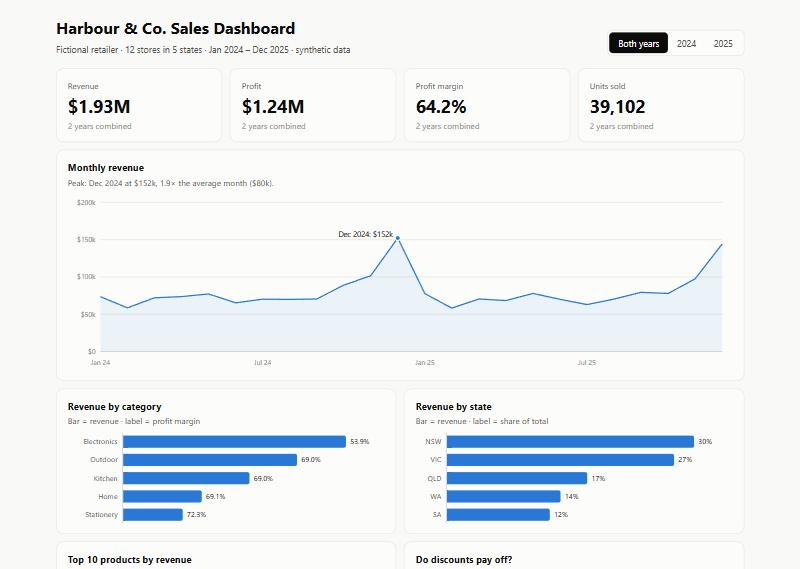

# Retail Sales Analysis – Harbour & Co.

**[View the live dashboard →](https://ibbygit77.github.io/retail-sales-analysis/)**

An end-to-end sales analysis for a fictional Australian retailer: SQL queries answer four business questions, and an interactive web dashboard presents the results for managers.



## Business questions
1. Which products and categories drive revenue and profit?
2. How do sales change month to month — is there seasonality?
3. Which stores and states perform best?
4. Are discounts helping sales, or just hurting profit?

## Key insights
| # | Finding | Recommendation |
|---|---|---|
| 1 | **December averages $148k — 1.8× a typical month.** November and December together bring 26% of yearly revenue. | Start Christmas stock and staffing plans in October. |
| 2 | **Electronics is 34% of revenue but has the lowest margin (53.9% vs 64.2% overall).** The Smart Watch alone is 12% of all revenue. | Review Electronics pricing and supplier costs; reduce reliance on one product. |
| 3 | **Discounts don't pay for themselves.** A 30% discount sells 32% more units per order line, but profit per line falls 26% ($62 → $46). | Limit deep discounts; test 10% offers, which keep most of the margin. |
| 4 | **NSW and Victoria bring 57% of revenue** from 6 of the 12 stores. Sydney CBD is the top store. | Prioritise marketing and new-store investment on the east coast. |
| 5 | **Revenue fell 1.9% in 2025** while margin held at 64.4%. | Focus on growing volume rather than cutting costs. |

## How it works
```
data/generate_data.py   →  CSV files (stores, products, ~20,600 order lines)
load_db.py              →  SQLite database (sales.db)
sql/*.sql               →  analysis queries
build_dashboard_data.py →  docs/data.js
docs/index.html         →  interactive dashboard (GitHub Pages)
```

| Folder / file | What's in it |
|---|---|
| [`sql/01_explore.sql`](sql/01_explore.sql) | Getting to know the data: counts, date range, categories |
| [`sql/02_revenue.sql`](sql/02_revenue.sql) | A `sales` view joining the 3 tables; revenue and profit by category, state, store, product |
| [`sql/03_trends_and_discounts.sql`](sql/03_trends_and_discounts.sql) | Monthly trend, seasonality and discount analysis |
| [`docs/`](docs/) | The dashboard: plain HTML, CSS and JavaScript, no frameworks |

**Formulas used**
- Revenue = quantity × unit price × (1 − discount)
- Profit = revenue − quantity × unit cost
- Margin = profit ÷ revenue

## Run it yourself
Needs only Python 3 (no extra packages).
```powershell
python data/generate_data.py
python load_db.py
python run_query.py sql/02_revenue.sql
python build_dashboard_data.py
python -m http.server 8000 --directory docs   # then open http://localhost:8000
```

## About the data
The data is **synthetic** — generated with a fixed random seed so results are reproducible and no real company's information is shared. It includes realistic patterns (a Christmas peak, summer demand for outdoor products, busier city stores) for the analysis to uncover.

## About this project
Built by **Ibrahim Camara** (Bachelor of Commerce, Business Information Systems, Macquarie University) while learning SQL and Python, with [Claude Code](https://claude.com/claude-code) used as a coding assistant and tutor. See [LEARNING_PATH.md](LEARNING_PATH.md) for how I'm working through each part, including rebuilding the dashboard in Power BI.
