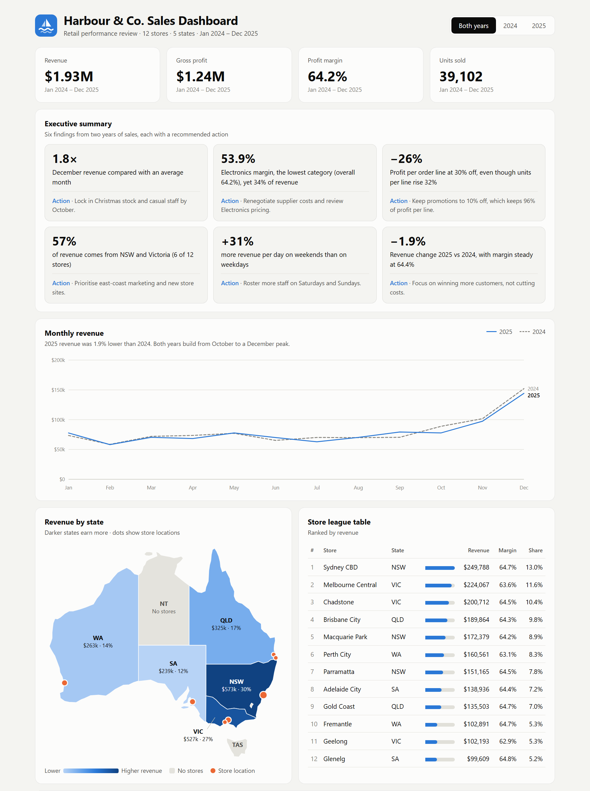
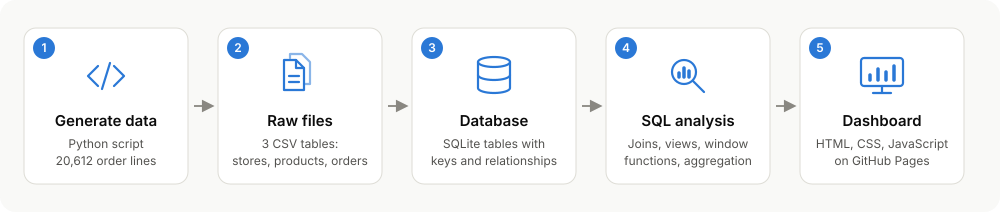
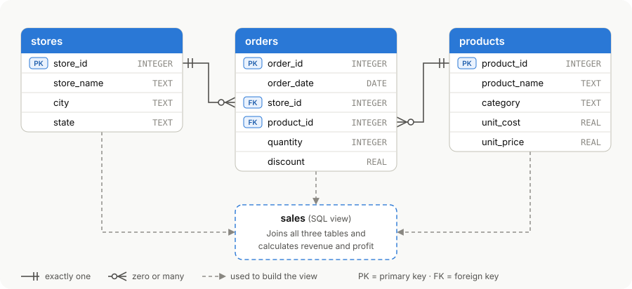

# Retail Sales Analysis – Harbour & Co.

**[▶ Open the live dashboard](https://ibbygit77.github.io/retail-sales-analysis/)**

A two-year performance review of a fictional Australian retailer with 12 stores in 5 states. SQL queries answer the business questions, and an interactive dashboard presents the findings with recommended actions for management.



## Business questions
1. Which products and categories drive revenue and profit?
2. How do sales change across the year, and does each category follow the same pattern?
3. Which states and stores perform best?
4. Are discounts helping sales, or just hurting profit?
5. When in the week should the business staff up?

## Key findings and recommendations
| # | Finding | Recommendation |
|---|---|---|
| 1 | **December averages $148k, 1.8× a typical month.** November and December bring 26% of yearly revenue. | Lock in Christmas stock and casual staff by October. |
| 2 | **Electronics is 34% of revenue but has the lowest margin** (53.9% vs 64.2% overall). The Smart Watch alone is 12% of all revenue. | Renegotiate supplier costs and review Electronics pricing. |
| 3 | **Discounts don't pay for themselves.** At 30% off, units per order line rise 32% but profit per line falls 26% ($62 → $46). | Keep promotions to 10% off, which keeps 96% of profit per line. |
| 4 | **NSW and Victoria bring 57% of revenue** from 6 of the 12 stores. Sydney CBD is the top store. | Prioritise east-coast marketing and new store sites. |
| 5 | **Weekends bring 31% more revenue per day** than weekdays ($3.2k vs $2.4k). | Roster more staff on Saturdays and Sundays. |
| 6 | **Revenue fell 1.9% in 2025** while margin held at 64.4%. | Focus on winning more customers rather than cutting costs. |

## What the dashboard shows
- **KPI cards** for revenue, gross profit, margin and units, with year-on-year change
- **Monthly revenue**, 2025 against 2024
- **Map of Australia** shaded by state revenue, with store locations
- **Store league table** with revenue, margin and share
- **Seasonality heatmap**: each category's months compared with its average month
- **Category, weekday, product and discount** breakdowns
- A **year filter** that updates every chart

## How it was built


| Step | File | What it does |
|---|---|---|
| 1 | [`data/generate_data.py`](data/generate_data.py) | Creates the dataset: 12 stores, 40 products, 20,612 order lines (2024–2025) |
| 2 | `data/*.csv` | The three raw tables |
| 3 | [`load_db.py`](load_db.py) | Builds the SQLite database with primary and foreign keys |
| 4 | [`sql/`](sql/) | The analysis queries (below) |
| 5 | [`build_dashboard_data.py`](build_dashboard_data.py) → [`docs/`](docs/) | Exports query results and powers the dashboard |

### Database design


### SQL files
| File | Questions answered | Techniques |
|---|---|---|
| [`01_explore.sql`](sql/01_explore.sql) | Size, date range and make-up of the data | `COUNT`, `MIN`/`MAX`, `GROUP BY` |
| [`02_revenue.sql`](sql/02_revenue.sql) | Revenue and profit by category, state, store and product | `JOIN`, `CREATE VIEW`, calculated columns |
| [`03_trends_and_discounts.sql`](sql/03_trends_and_discounts.sql) | Monthly trend, seasonality, discount impact | date functions, `CASE` |
| [`04_seasonality.sql`](sql/04_seasonality.sql) | Category seasonality and weekday patterns | CTEs, window functions (`AVG() OVER`) |

**Formulas:** revenue = quantity × unit price × (1 − discount) · profit = revenue − quantity × unit cost · margin = profit ÷ revenue

## Run it yourself
Needs only Python 3, with no extra packages.
```powershell
python data/generate_data.py
python load_db.py
python run_query.py sql/02_revenue.sql
python build_dashboard_data.py
python -m http.server 8000 --directory docs   # then open http://localhost:8000
```

## About the data
The data is **synthetic**: it was generated with a fixed random seed, so results are reproducible and no real company's information is used. It contains realistic patterns (a Christmas peak, summer demand for outdoor products, busier weekends and city stores) for the analysis to uncover.

## Next steps
- Rebuild the dashboard in **Power BI** with DAX measures
- Forecast 2026 monthly revenue
- Add customer data to analyse repeat purchases and basket size

---
**Ibrahim Camara** · Bachelor of Commerce (Business Information Systems), Macquarie University · [LinkedIn](https://www.linkedin.com/in/ibrahim-camara-832177325/)
